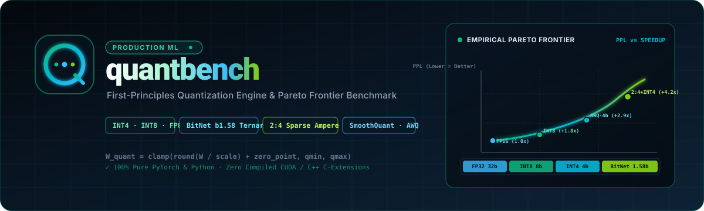

<p align="center">
  
</p>

# quantbench ⚖️

[](https://pypi.org/project/quantbench-engine/)
[](https://github.com/Prajwal7-2002/quantbench/actions)
[](LICENSE)
[](https://www.python.org/)
[](#)

A **unified, first-principles quantization engine, bit-packing runtime, 2:4 sparsity toolkit, and Quality-vs-Speed Pareto evaluation benchmark** in pure Python and PyTorch.

Most developers treat LLM quantization as a black box: they download GGUF or AWQ checkpoints without knowing how scales and zero-points are calculated, how 4-bit signed integers are packed into memory bytes, or why activation outliers in attention layers make naive INT8 quantization collapse.

`quantbench` implements these production algorithms from scratch with **radical transparency and zero compiled C++/CUDA dependencies**, and provides a benchmark CLI that measures empirical perplexity degradation alongside generation throughput.

---

## ⚡ Core Architecture

```
┌────────────────────────────────────────────────────────────────────────────────────────┐
│                                  quantbench                                            │
│            (Single Unified Repository: First-Principles Engine + Benchmark)            │
│                                                                                        │
│  ┌────────────────────────────────────────┐  ┌───────────────────────────────────────┐ │
│  │ 1. From-Scratch Quant Engine (quant)   │  │ 2. Drop-in Neural Layers (nn)         │ │
│  │ • Uniform Affine (Scale & Zero-Point)  │  │ • QuantLinear (PyTorch Module)        │ │
│  │ • Symmetric AbsMax (Per-Tensor/Channel)│  │ • In-Place Model Converter (Qwen2.5,  │ │
│  │ • Blockwise (Group Size 32, 64, 128)   │  │   SmolLM2-135M, GPT-2)                │ │
│  │ • INT4 Nibble Packing (uint8 vectors)  │  │ • Forward GEMM with dynamic dequant   │ │
│  │ • Sub-2-bit Ternary Packing (BitNet)   │  │ • Layer-by-Layer SQNR Diagnostics     │ │
│  │ • 2:4 Structured Sparsity (Ampere)     │  │                                       │ │
│  │ • SmoothQuant Outlier Migration        │  │                                       │ │
│  │ • AWQ Grid Search & GPTQ Hessian/Chol  │  │                                       │ │
│  └───────────────────┬────────────────────┘  └───────────────────┬───────────────────┘ │
│                      │                                           │                     │
│                      └─────────────────────┬─────────────────────┘                     │
│                                            │ Powers                                    │
│                                            ▼                                           │
│  ┌───────────────────────────────────────────────────────────────────────────────────┐ │
│  │ 3. Rigorous Evaluation & Profiling (eval & bench)                                 │ │
│  │ • Perplexity Engine: Sliding-window evaluation on WikiText-2 & C4                 │ │
│  │ • Diagnostics: SQNR (dB), Max Error, Outlier Dimension Detection                  │ │
│  │ • Hardware Profiler: servebench bridge (Tokens/sec, TTFT, Peak VRAM in MB)        │ │
│  │ • Terminal ASCII Pareto Visualizer: Generates live Quality vs Speed tradeoff curve│ │
│  └───────────────────────────────────────────────────────────────────────────────────┘ │
└────────────────────────────────────────────────────────────────────────────────────────┘
```

---

## 📐 Mathematical Foundations

### 1. Affine Asymmetric Quantization
Quantizes a floating-point tensor $x \in [x_{\min}, x_{\max}]$ into integer range $[q_{\min}, q_{\max}]$:
$$s = \frac{x_{\max} - x_{\min}}{2^b - 1}, \quad z = \text{round}\left(-\frac{x_{\min}}{s}\right) + q_{\min}$$
$$q = \text{clamp}\left(\text{round}\left(\frac{x}{s}\right) + z, \; q_{\min}, \; q_{\max}\right)$$
$$\hat{x} = (q - z) \cdot s$$

### 2. Symmetric AbsMax Quantization
Centers dynamic range at zero ($z = 0$), enabling direct hardware integer GEMM without per-element zero-point subtractions:
$$s = \frac{\max(|x|)}{2^{b-1} - 1}, \quad q = \text{clamp}\left(\text{round}\left(\frac{x}{s}\right), \; -2^{b-1}, \; 2^{b-1}-1\right)$$
$$\hat{x} = q \cdot s$$

### 3. Block-Wise (Group-Wise) Quantization
Partitions weights into blocks of size $G \in \{32, 64, 128\}$ to isolate channel outliers and preserve precision across wide layers.

### 4. OCP FP8 Emulation
Bit-exact simulation of **E4M3FN** (higher mantissa precision, range $\pm 448$, no infinity) for GEMM weights/activations and **E5M2** (wider dynamic range $\pm 57344$) for gradients and KV caches.

### 5. Sub-Byte Bit-Packing & 2:4 Sparsity
Because hardware cannot address sub-byte boundaries, weights are packed into vectorized `uint8` containers:
* **INT4**: Two 4-bit nibbles packed per byte: `(v0 & 0x0F) | ((v1 & 0x0F) << 4)` ($4\times$ memory compression vs FP16).
* **BitNet Ternary**: Four $\{-1, 0, 1\}$ weights per byte using offset binary mapping ($8\times$ compression vs FP16).
* **2:4 Structured Sparsity**: Two non-zero values retained per 4-element block (50% storage) with 2-bit column positions packed into 4-bit metadata nibbles for Ampere/Ada/Hopper Sparse Tensor Cores ($2\times$ TFLOPS).

---

## 📦 Installation

Install `quantbench` directly from [PyPI](https://pypi.org/project/quantbench-engine/):

```bash
pip install quantbench-engine
```

Or using [uv](https://docs.astral.sh/uv/):

```bash
uv add quantbench-engine
```

To install from source for development:

```bash
git clone https://github.com/Prajwal7-2002/quantbench.git
cd quantbench
uv sync
```

---

## 🚀 Quickstart

### Sub-Byte Packing Inspection

Inspect how weights are packed into vectorized byte streams and calculate theoretical compression:

```bash
# Inspect sub-byte bit layouts and theoretical memory compression
uv run quantbench pack-inspect --format int4
uv run quantbench pack-inspect --format ternary
uv run quantbench pack-inspect --format sparse24
```

### Running the Test Suite

```bash
# Run the complete test suite (47 tests, 95% coverage)
uv run pytest
```

### Python API Quickstart

```python
import torch
import torch.nn as nn
from quantbench import QuantLinear, convert_model_to_quant

# 1. Convert any standalone nn.Linear to INT4 QuantLinear
linear = nn.Linear(4096, 4096)
quant_linear = QuantLinear.from_linear(linear, scheme="int4", group_size=64)

x = torch.randn(2, 4096)
y = quant_linear(x)  # Dynamic vectorized dequantization forward
stats = quant_linear.memory_footprint_bytes()
print(
    f"Compression: {stats['compression_ratio']:.2f}x "
    f"({stats['fp16_bytes']} -> {stats['compressed_bytes']} bytes)"
)

# 2. In-place recursive transformer conversion
model = MyTransformer()
converted_model, stats = convert_model_to_quant(
    model,
    scheme="int4",
    group_size=64,
    exclude_modules=["lm_head"],
)
print(
    f"Compressed {stats['converted_layers']} layers: "
    f"{stats['orig_memory_mb']} MB -> {stats['quant_memory_mb']} MB "
    f"({stats['compression_ratio']}x)"
)

# 3. Advanced Calibration Algorithms (SmoothQuant, AWQ, GPTQ)
from quantbench import (
    smooth_linear_weights,
    extract_activation_channel_scales,
    search_best_awq_scale,
    compute_activation_channel_means,
    gptq_quantize_weights,
    compute_activation_hessian,
)

# SmoothQuant: Migrate activation outlier dynamic range to weights
act_scales = extract_activation_channel_scales(linear, calibration_x)
w_smoothed, scale = smooth_linear_weights(linear.weight, act_scales, alpha=0.5)

# AWQ: Search optimal per-channel protection scales
act_means = compute_activation_channel_means(calibration_x)
best_scale, best_alpha = search_best_awq_scale(linear.weight, act_means, calibration_x)

# GPTQ: Second-order Hessian error compensation with Cholesky damping
h = compute_activation_hessian(calibration_x, in_features=4096)
w_gptq = gptq_quantize_weights(linear.weight, h, bits=4, block_size=32, damping_factor=0.01)

# 4. Pareto Quality-vs-Compression Benchmark
from quantbench import ParetoBenchmark, generate_synthetic_corpus

tokens = generate_synthetic_corpus(vocab_size=32000, seq_length=1024)
bench = ParetoBenchmark(model, tokens, window_size=512, stride=256)
points = bench.run_sweep()
print(bench.render_ascii_table(points))
```

### CLI Quickstart

```bash
# Evaluate tensor-level numerical fidelity (SQNR dB)
uv run quantbench eval --shape 1024x1024

# Run automated Pareto sweep across all precision runtimes
uv run quantbench pareto --vocab-size 128 --hidden-dim 128 --seq-len 300
```

---

## 🔬 Executable Examples & Roofline Integration

The repository includes runnable end-to-end scripts demonstrating drop-in inference, advanced calibration, and hardware roofline modeling (integrating with `servebench`):

* **[examples/01_quant_linear_inference.py](examples/01_quant_linear_inference.py)**: Demonstrates converting PyTorch `nn.Linear` layers into INT4 blockwise, BitNet 1.58b ternary, and Ampere 2:4 sparse `QuantLinear` modules, verifying forward pass execution and recursive transformer conversion with `lm_head` float exclusion.
* **[examples/02_advanced_calibration.py](examples/02_advanced_calibration.py)**: Step-by-step demonstration of SmoothQuant outlier migration (proving exact mathematical continuous invariance), AWQ Frobenius grid search for salient channel protection, and GPTQ second-order Hessian Cholesky damping updates yielding $1.48\times$ error reduction.
* **[examples/03_servebench_roofline_eval.py](examples/03_servebench_roofline_eval.py)**: Bridges `quantbench` drop-in layers with `servebench`'s hardware roofline model (`HARDWARE_PROFILES`, RTX 3050 192 GB/s, T4 320 GB/s), calculating arithmetic intensity $I = \frac{2}{\text{bytes\_per\_param}}$ FLOPs/byte, decode token latency, and DRAM bandwidth traffic reduction (slashing memory traffic by 73.4% for INT4).

```bash
uv run python examples/01_quant_linear_inference.py
uv run python examples/02_advanced_calibration.py
uv run python examples/03_servebench_roofline_eval.py
```

---

## 📚 Educational Engineering Guide

For an exhaustive first-principles mathematical and architectural breakdown of quantization, sub-byte bit packing, and hardware sparsity, read [GUIDE.md](GUIDE.md):
* Exact mathematical proofs (Zero-Preserving Affine Invariant, Optimal Brain Surgeon update derivation).
* IEEE 754 Banker's rounding drift analysis.
* OCP FP8 (E4M3FN vs E5M2) analytical software emulation.
* Bit-level packing mechanics (INT4 two's complement sign extension, BitNet biased SIMD vs Base-3, NVIDIA Ampere 2:4 metadata nibbles).
* Second-order Hessian error compensation with Cholesky inversion and block updates.
* Dual-metric Pareto benchmarking (Layer-level SQNR dB + Sliding-Window Perplexity).

---

## 🗺️ Roadmap & Staged Milestones

- [x] **Phase 1: Mathematical Primitives & Invariants**: Affine, AbsMax, Group-wise, and FP8 (E4M3/E5M2) simulation with rigorous error bound verification.
- [x] **Phase 2: Integer Bit-Packing Runtimes**: Vectorized INT4 nibble packing (`uint8`), BitNet ternary packing, and 2:4 sparsity metadata.
- [x] **Phase 3: Drop-in Neural Layers**: `QuantLinear` PyTorch module, in-place Hugging Face model converter, and buffer serialization.
- [x] **Phase 4: Advanced Calibration Algorithms**: SmoothQuant outlier migration, AWQ grid search, and GPTQ second-order Hessian updates.
- [x] **Phase 5: Perplexity & Evaluation Engine**: Standardized sliding-window perplexity on WikiText-2 and C4.
- [x] **Phase 6: Pareto Benchmark & Terminal Visualizer**: Quality-vs-compression analysis and terminal Rich Pareto curves.
- [x] **Phase 7: Public Learning Guide & Packaging**: Comprehensive educational walkthrough and PyPI release.
- [ ] **Phase 8: Sub-Byte Fused Kernels & KV Cache Quantization**: Analytical Triton kernel emulators for mixed-precision GEMV and INT4 KV-cache compression.

---

## 🤝 Contributing

We welcome contributions that expand educational clarity, add new calibration methods, improve numerical fidelity diagnostics, or introduce new sub-byte bit layouts! Please see [CONTRIBUTING.md](CONTRIBUTING.md) for full development guidelines, testing protocols, and PR standards.

---

## 📜 License

Apache 2.0. See [LICENSE](LICENSE) for details.
